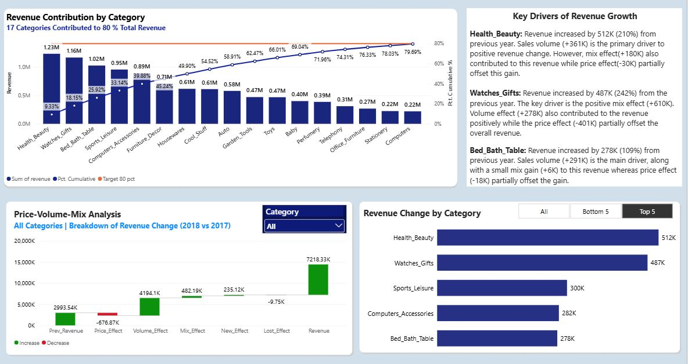

# Olist-Revenue-Analysis
Revenue analysis on olist e-commerce dataset (PostgreSQL + Power BI + python)
## Pareto analysis (80/20)
**Question:** Which product categories bring 80% of total revenue?

**Key Findings:** 17 out of 74 Categories Bring ~80 % of total revenue.

**Methodology:** 
 -Aggregating revenue by product category (SUM)
 -Sorting categories by revenue (ORDER BY)
 -Calculating cumulative revenue using window functions (SUM() OVER)
 -Calculating cumulative revenue percentage to identify the categories contributing to approximately 80% of total revenue
 
**Scope:**
- Delivered orders only, 2017-2018 (2016 excluded as only 4 months data are available)
- Revenue = item price, freight cost is excluded.
  
**Files:**
  - `pareto_analysis.sql`: the full postgreSQL query
  - `pareto_chart.png`: Pareto chart in  Power BI

## Price-Volume-Mix (PVM) analysis

**Question:** What drove the revenue growth between 2017 and 2018?

**Key Findings:** (Jan-Aug, 2018 vs 2017):

- Revenue grew from 2,993.5K to 7,218.3K
- Volume effect: +4,194.1K (main driver, more units sold)
- Mix effect: +482.2K
- New category-months: +235.1K
- Lost category-months: -9.8K
- Price effect: -676.9K (average prices went down)
- Top categories by revenue growth: Health_Beauty (+512K), Watches_Gifts (+487K), Bed_Bath_Table (+278K)

**Methodology:**

- Compared 2018 with 2017 (Jan-Aug) for each category and month
- Price effect = 2018 qty x (2018 avg price - 2017 avg price)
- Volume effect = (expected qty - 2017 qty) x 2017 avg price
- Mix effect = (2018 qty - expected qty) x 2017 avg price
- Expected qty = the category's 2017 share of monthly units x total 2018 monthly units
- New effect = revenue from category-months with no 2017 sales
- Lost effect = 2017 revenue from category-months with no 2018 sales
- Checked the result: price + volume + mix + new - lost = actual revenue change

**Scope:**

Delivered orders only
Revenue = item price, freight cost is excluded
Months 1-8 only, because 2018 data ends in August (fair comparison)
New and lost are counted per category and month

**Files:**
- [`price_volume_mix.sql`](price_volume_mix.sql): the full PostgreSQL query
- [`price_volume_mix.png`](price_volume_mix.png): price-volume-mix waterfall chart in Power BI

**Tools**

Python (only for data cleaning), PostgreSQL, Power BI

**Dataset:** Olist Brazilian E-Commerce (Kaggle)
  ## Upcoming
  - Full Power BI dashboard
  

 
